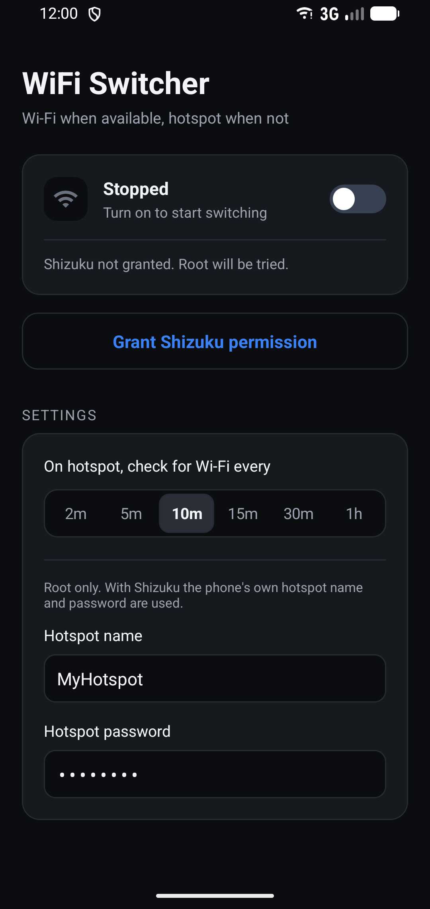

# WiFi Switcher

**Wi-Fi when it's there. Hotspot when it's not. Hands-free.**

### [⬇ Download the APK](../../releases/latest)

| Light | Dark | In action |
| :---: | :---: | :---: |
|  |  |  |

A small Android app that flips your phone between Wi-Fi and mobile hotspot on its own:

| Your phone is… | WiFi Switcher does… |
| --- | --- |
| Connected to a saved Wi-Fi | Turns **off** mobile data and hotspot |
| Away from Wi-Fi | Turns **on** mobile data and hotspot |

Handy when your phone is the internet source for a laptop, tablet or a second phone, and you keep forgetting to switch.

## Download

Get the latest APK from the **[Releases page](../../releases/latest)**, copy it to your phone and install it (allow "Install unknown apps" when asked).

## Requirements

- Android 8.0+ (built and tested for **Android 11**)
- **[Shizuku](https://shizuku.rikka.app/)** (no root needed), **or** a rooted phone

## How it works

- While the hotspot is on, the phone can't scan for Wi-Fi (both use the same radio). So every **N minutes** (default 10) the app pauses the hotspot for about 25 seconds to look for a saved Wi-Fi. Devices on your hotspot drop for those seconds.
- It only joins Wi-Fi networks already saved on your phone.
- It starts again by itself after the phone restarts.

## Setup

### 1. Give it permission with Shizuku

1. Install **Shizuku** from the Play Store.
2. Settings → About phone → tap **Build number** 7 times (turns on Developer options).
3. Developer options → turn on **Wireless debugging**.
4. Open Shizuku → **Start via Wireless debugging** → follow the pairing steps.
5. Open WiFi Switcher → **Grant Shizuku permission** → Allow.

> After a phone restart, open Shizuku and start it again (an Android 11 limit).
> Rooted phone? Skip Shizuku; the app uses root automatically.

### 2. Turn it on

Flip the power switch. The status shows in the notification.

- With Shizuku, the hotspot uses the name and password from **Settings → Connections → Mobile Hotspot**. The name/password fields in the app apply only on rooted phones.
- Settings → Apps → WiFi Switcher → Battery → **Unrestricted**. Otherwise the phone may stop the app in the background.

## Troubleshooting

**The hotspot doesn't turn on.** Some brands (Xiaomi, Samsung, etc.) change the hotspot code. The status line shows the error. [Open an issue](../../issues) with that message and your phone model.

## Build from source

1. Install [Android Studio](https://developer.android.com/studio).
2. File → Open → this folder. Wait for Gradle sync.
3. Build → Build APK(s). The file lands in `app/build/outputs/apk/debug/`.

Or from a terminal: `./gradlew assembleDebug`

## Versions

Each release is a git tag (`v1.0.0`, …) with its APK attached on the [Releases page](../../releases). The app's version lives in `app/build.gradle` (`versionName`, `versionCode`).

## Built with

Kotlin · [Shizuku API](https://github.com/RikkaApps/Shizuku-API) · [HiddenApiBypass](https://github.com/LSPosed/AndroidHiddenApiBypass)
